<div align="center">
  

  <a href="https://git.io/typing-svg">
    
  </a>

  <br/><br/>

  <a href="https://imeshhirushan2117-65a31.web.app/"></a>
  <a href="https://www.linkedin.com/in/imesh-hirushan-b2aab1224/"></a>
  <a href="mailto:imeshhirushan2117@gmail.com"></a>
  <a href="https://wa.me/0779201232"></a>
  
</div>

<br/>


<table>
  <tr>
    <td width="55%" valign="top">

```yaml
name:      Imesh Hirushan
alias:     HiruBro
role:      Associate Developer
company:   Supervision Technology
education: Undergraduate @ IJSE
country:   Sri Lanka 🇱🇰
focus:
  - Web Development
  - ERP Systems
  - Mobile Development
learning:
  - Spring Boot
  - React Native
  - System Design
reach_me:  imeshhirushan2117@gmail.com
```

</td>
<td width="45%" valign="top">

### ⚡ Right now

- 💼 Associate Developer @ **Supervision Technology**
- 🔭 Building full-stack projects
- 🌱 Levelling up in Java & React
- 💬 Ask me about **React, Java, Laravel**
- 🤝 Open to collaborate on cool ideas

</td>
</tr>
</table>

<br/>


<div align="center">

**Languages**


**Frontend**


**Mobile**

 React Native

**Backend**


**Databases**


**Tools**


**OS**


</div>

<br/>


<!-- Replace REPO_NAME_1, REPO_NAME_2, REPO_NAME_3 and REPO_NAME_4 with your actual public repository names. -->
<div align="center">

<a href="https://github.com/imeshhirushan2117/REPO_NAME_1"></a>
<a href="https://github.com/imeshhirushan2117/REPO_NAME_2"></a>

<a href="https://github.com/imeshhirushan2117/REPO_NAME_3"></a>
<a href="https://github.com/imeshhirushan2117/REPO_NAME_4"></a>

</div>

<br/>


<div align="center">
  
  
  
  
  
</div>

<br/>


<div align="center">
  <picture>
    <source media="(prefers-color-scheme: dark)" srcset="https://raw.githubusercontent.com/imeshhirushan2117/imeshhirushan2117/output/github-snake-dark.svg">
    <source media="(prefers-color-scheme: light)" srcset="https://raw.githubusercontent.com/imeshhirushan2117/imeshhirushan2117/output/github-snake.svg">
    
  </picture>
</div>

<br/>


<div align="center">
  
</div>

<br/>


<div align="center">

<a href="https://www.facebook.com/imesh.hirushan.98/"></a>
<a href="https://www.instagram.com/_imesh_hirushan_/"></a>
<a href="https://twitter.com/imesh_57"></a>
<a href="https://github.com/imeshhirushan2117"></a>

<br/><br/>

<a href="https://www.buymeacoffee.com/"></a>

<br/><br/>


</div>
